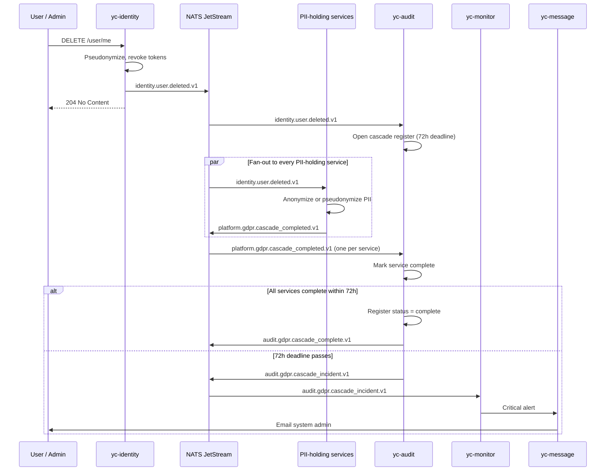

# GDPR Cascade

How user deletion propagates across services. Implements ADR-005.

## Trigger

A validated user deletion request (customer-initiated or admin-initiated)
causes yc-identity to:

1. Generate a pseudonym for the user.
2. Anonymize the user record in yc-identity.
3. Revoke all refresh tokens.
4. Publish `identity.user.deleted.v1` carrying both `user_id` and `pseudonym`.

## Flow



## Participating Services

Every service with user-linked PII must subscribe to `identity.user.deleted.v1` and publish `platform.gdpr.cascade_completed.v1` when done. This table, ADR-005 and yc-audit's `expected_services` configuration must list the same services.

| Service | Action | Notes |
| ------- | ------ | ----- |
| yc-identity | Anonymize user record | Owns the trigger; pseudonym map retained |
| yc-preference | Delete all preferences | Clean delete; no retention requirement |
| yc-cart | Delete all carts | Clean delete |
| yc-review | Anonymize reviews | Author name replaced; review content retained for integrity |
| yc-orders | Pseudonymize user_id | Financial retention (7 years); orders remain, user link anonymized |
| yc-shipping | Pseudonymize address | After operational window (2 years) |
| yc-checkout | Pseudonymize sessions | Non-terminal: now. Terminal: after operational window (90 days) |
| yc-message | Anonymize address | After operational window (90 days); content purged |
| yc-inventory | Delete subscriptions | Back-in-stock subscriptions deleted | 
| yc-product | Delete favourites | customer_favourites_projection rows deleted |
| yc-payment | No deletion | Financial record retention; actor_id on manual actions pseudonymized |
| yc-audit | Retain in full | Compliance requires proof of cascade |
| yc-analytics | Pseudonymize in facts | Facts retained for financial reporting; aggregates rebuild from pseudonymized facts |

## Rules

1. **The cascade is authoritative** — a service that fails to subscribe silently is a compliance bug; CI should enforce subscription coverage against the participating services list.
2. **72-hour deadline** — measured from publish of identity.user.deleted.v1. yc-audit opens the register with initiated_at and compares.
3. **Anonymize vs delete** — services choose per their retention needs (table above). The envelope distinction:
 - **Delete**: row removed entirely.
 - **Anonymize**: PII fields nullified or replaced; row structure retained.
 - **Pseudonymize**: user_id replaced with the pseudonym from yc-identity's pseudonym map; other fields may be retained.
4. **Pseudonym map is retained** in yc-identity under legal hold. It is the only bridge from user_id to pseudonym. Access is logged in yc-audit.
5. **Historical events on the bus are not deleted**. Retention policy (ADR-004) ages them out. Future events referencing the deleted user carry the pseudonym.
6. **Incident response** — when a service does not report completion within 72 hours, follow docs/runbooks/gdpr-incident-response.md.

## Verification

A deletion is complete when:

```bash
curl /sysadmin/gdpr/register/<user_id>
```

returns:

```json
{
  "user_id": "...",
  "pseudonym": "anon-...",
  "status": "complete",
  "initiated_at": "...",
  "completed_at": "...",
  "expected_services":  ["yc-identity", "yc-preference", "...", "yc-analytics"],
  "completed_services": ["yc-identity", "yc-preference", "...", "yc-analytics"]
}
```

## Testing

An end-to-end GDPR cascade test lives in `test/e2e/gdpr_cascade_test.go`. It:
1. Provisions a test tenant.
2. Registers a test customer with preferences, cart items, a placed order, and a review.
3. Triggers deletion.
4. Polls the cascade register.
5. Asserts every expected service reports complete within the test timeout (short in CI; 72h in production).
6. Asserts PII is absent in all services; pseudonymized references exist where retention requires.
See ADR-005 for the full policy and `docs/runbooks/gdpr-incident-response.md` for operational response when a cascade fails.

## Open Points

1. **Keep the lists in sync.** yc-audit's `expected_services` is the enforcement point: a listed service that never reports becomes an incident, while a service holding PII that is missing from the list is a silent compliance bug. A CI check should cross-reference that configuration with this table.
2. **Pseudonymize vs anonymize.** Pseudonymization is reversible through yc-identity's pseudonym map; anonymization is not. Services that pseudonymize (yc-orders, yc-payment, yc-shipping, yc-checkout, yc-analytics) depend on that map staying under legal hold. If it is ever destroyed, their data becomes anonymous retroactively. ADR-005 should state this before real tenants are onboarded.
3. **The 72-hour window is a design choice**, not a regulatory requirement. GDPR Article 17 requires erasure "without undue delay" and within one month. 72 hours is a deliberate safety margin; if services cannot meet it under load, widen it rather than let incidents become routine.
